# 科研绘图工作台图文操作手册

第一次打开工作台，可以从一张数据表开始，也可以直接导入已有 SVG。下面用同一组三电极循环伏安（CV）曲线演示两种改图方式：**要把某条线精确调到指定宽度，手动选中它并输入数值；要让 AI 从一片区域里挑出特定对象，先框选锚点，再用自然语言说明选谁、改什么。**

[安装工作台](../INSTALL.md) · [导入数据](#import-data) · [手动改线宽](#manual-stroke) · [框选锚点并用自然语言选择对象](#anchor-selection) · [查看历史](#edit-history) · [组图](#compose-figures) · [导出](#export-figure)

截图来自 2026-11-18 的本地开发版。「先建空版式」「放回组图」和组内 Ctrl + 单击等交互以该版本为准。

## 1　从数据表创建图表

在首页点 **从数据绘图 → 导入数据**，选择 CSV、JSON 或 Excel 文件。已经复制了表格内容时，也可以点 **粘贴数据**。手头有矢量图的读者可以从 **编辑已有 SVG → 导入 SVG** 开始，直接跳到下一节。

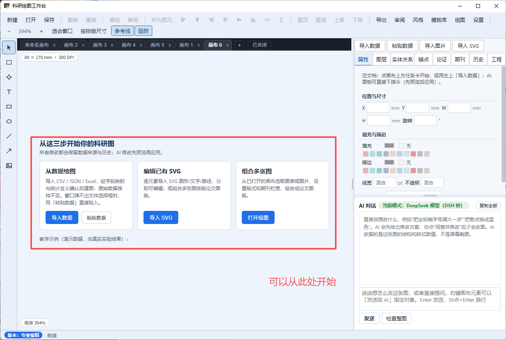

1. **看数据。** 核对行列数、列名和数值。示例文件 `cv-3el-materials.csv` 有 4,400 行、7 列。如果预览提示「下一步选好列后即可预览」，点 **下一步**。
2. **选图与映射。** 选择 **循环伏安 (CV) 曲线**。横轴选 `potential_vs_AgAgCl_V`（电位，V），纵轴选 `current_A`（电流，A）。截图按 `scan_rate_mV_s` 分组，所以图例显示扫速 10。要得到后文的 **M、S2 两条样品曲线**，把「分组／系列」改为 `sample`。
3. **创建图表。** 在 **画布与标题** 中设置尺寸和标题，进入 **确认** 核对映射，再点 **创建图表**。大表在向导中可以抽样预览，创建时使用全部数据。

查看导入向导的两张截图

**看数据**　上方检查文件读取结果，下方查看推荐图型。

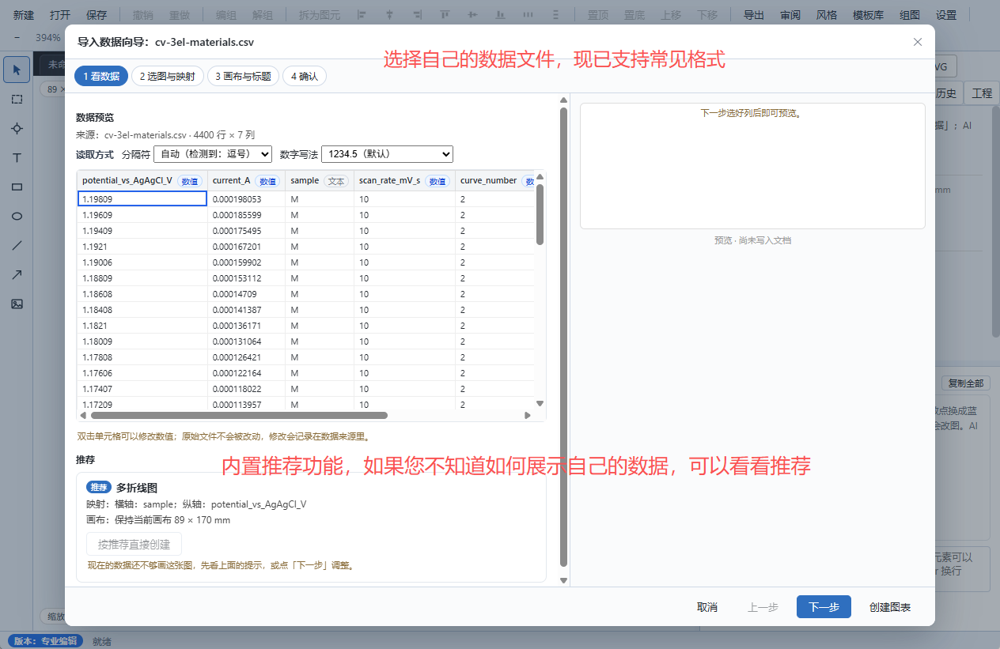

**选图与映射**　左侧分配数据列，右侧查看曲线预览。

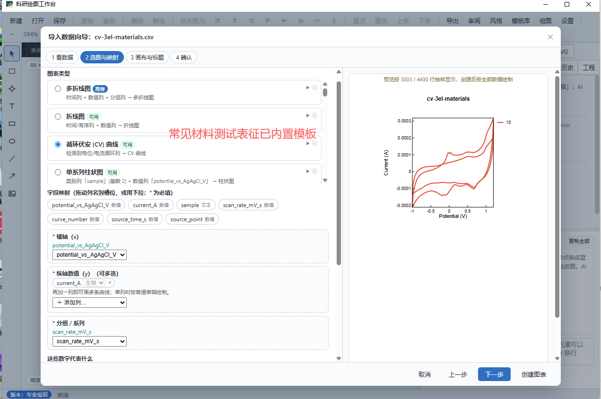

## 2　手动修改一条线的宽度

想把蓝色曲线调成 **0.8 pt**，可以直接在属性面板输入数值。下图以逐元素导入的 SVG 为例。

1. 点左侧箭头形的 **选择** 工具，在画布上点目标曲线。曲线位于组内时，用 **Ctrl + 单击** 选中路径，也可以在 **图层** 中展开组再选。右侧「属性」应显示 **已选 1 个：路径**。
2. 在右侧 **属性 → 填充与描边 → 线宽** 中输入 `0.8`，按 **Tab** 确认。旁边的「描边」色块用于改颜色；只需调线宽时，直接编辑数值框即可。
3. 对照另一条曲线检查效果。如果图例示意线也是独立路径，并且希望它和曲线同宽，再选中示意线，输入同一数值。

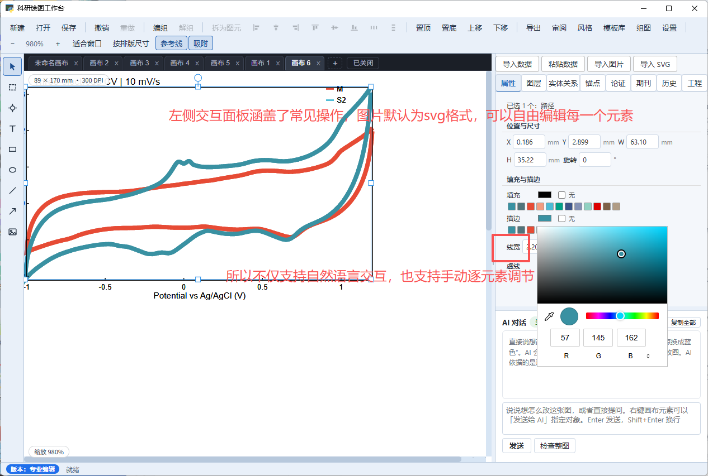

## 3　框选锚点，再用自然语言选择要改的对象

左下角可能同时有坐标轴、刻度、文字和两条曲线。**锚点指定在哪里找，自然语言指定要选哪些对象。** 例如，只想改左下角的 Y 轴刻度短线，就把“刻度短线”和要保留的对象都写进指令。

1. **框定区域。** 点左侧靶心形的 **锚点** 工具，在左下角拖出一个框。右侧「锚点」页会列出编号、位置和关联元素。确认 AI 输入框下方出现了对应引用，例如 `[1]`。
2. **描述选择条件和动作。** 在 **AI 对话** 输入下面的示例指令，点 **发送**。

   > 在 [1] 里，只选左侧 Y 轴的刻度短线，把它们改成深灰色。轴线、刻度文字以及红蓝两条曲线都保持原样。

3. **核对 AI 选中了谁。** 阅读回复，再看下方黄色的 **修改方案**。展开 **查看修改前后对比**，检查范围、对象和属性。如果方案写的是整个锚点，而你只想改刻度，点 **不改**，缩小框选范围或补充描述后重新发送。
4. **确认后应用。** 对象和效果都符合预期时，点 **同意并修改**。截图记录的是另一次线宽调整，黄色卡片列出了两项操作；上面的改色指令可用同一流程练习。

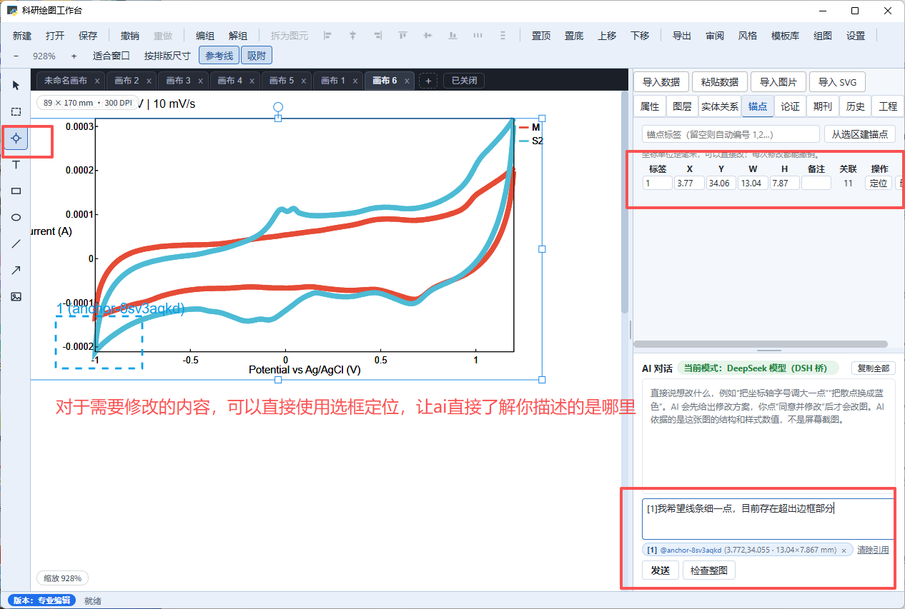

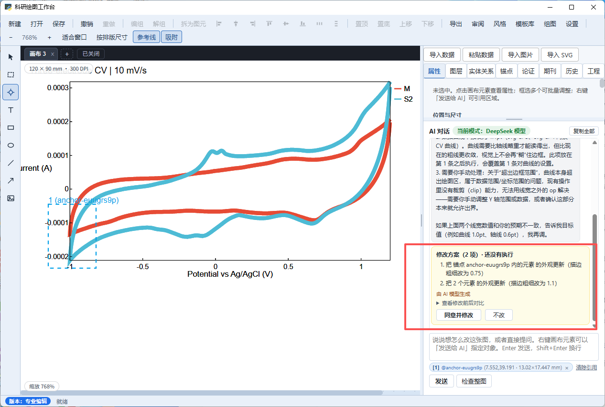

查看 AI 怎样解释选区，以及修改后到哪里检查

**读回复。** 对照画布检查 AI 提到的轴线、刻度和曲线。它对区域的描述可以帮助你发现框选过大的情况。

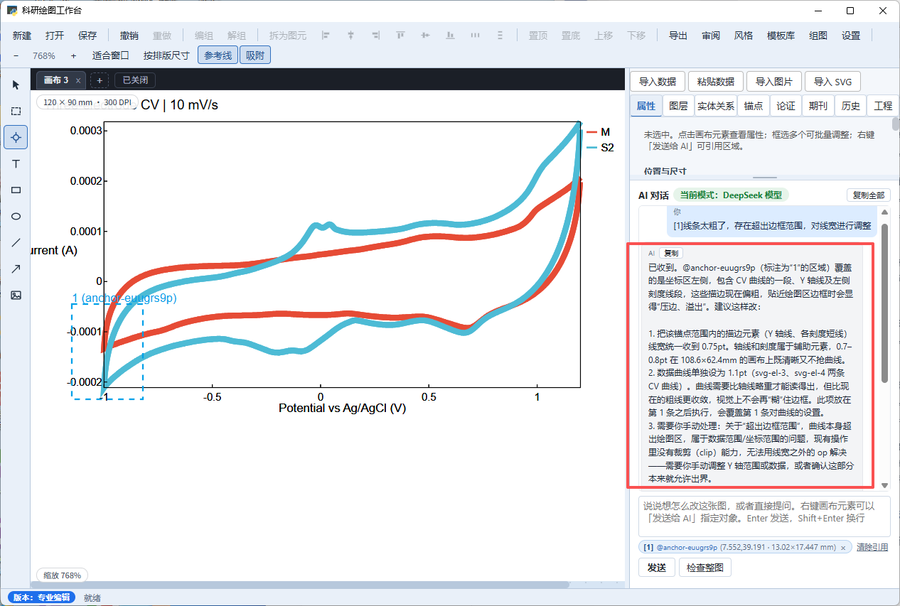

**看结果。** 选中实际路径，可在「属性」中复核数值。截图中的锚点列表已清空；如需再次指定区域，可重新框选。若曲线端点仍有间隙，可与原 SVG 或原始数据对照检查。

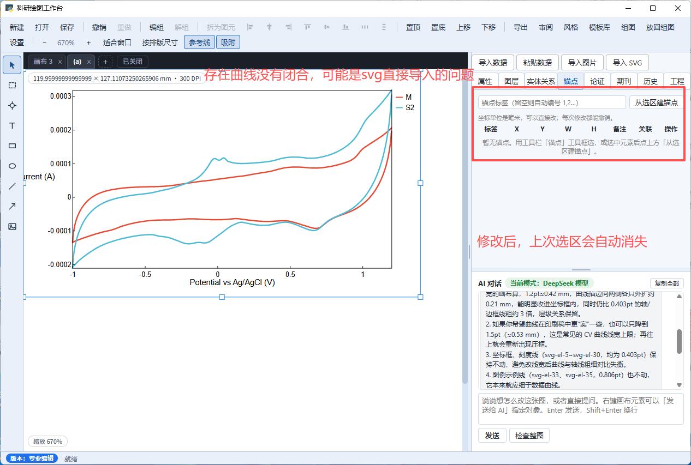

## 4　比较改动并还原

打开右侧 **历史**，按缩略图、操作说明和「用户／AI」标记找到目标记录。可先点 **版本对比**，再点该记录右侧的 **还原**，按提示确认。要留下可继续编辑的备份，点 **导出工程**。

查看历史记录和还原按钮

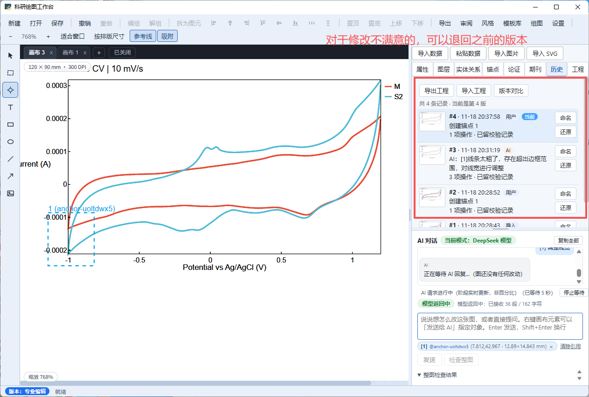

## 5　先选左右位置，再放入子图

从首页点 **打开组图**，或点顶部 **组图**。选择横排版式并点 **先建空版式**，然后单击要填的空位。例如点右侧的 **(b)** 格，对话框标题会显示 **放入图表 · (b)**。

- **已有两张图**：在对话框左栏勾选来源，点 **放入**。图源可以来自其他画布标签；希望连同标题一起放入时，可以选择 **整张画布**。
- **这个位置还没画图**：点 **新建子图画布**，在独立标签里绘图或导入文件。完成后点顶部 **放回组图**，子图就会复制到刚才选定的位置。对另一个空位重复操作。

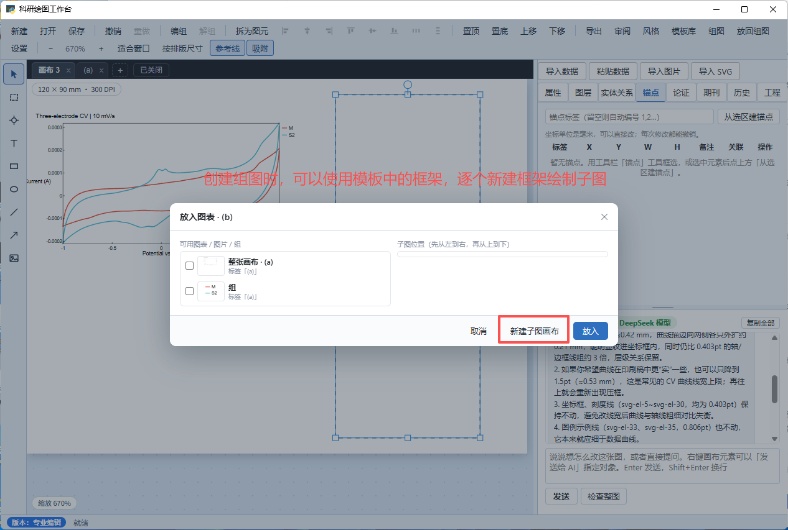

## 6　导出单图或整张组图

切换到要交付的画布，点顶部 **导出**。导出组图时选择 **整图画布**。需要可缩放的线条和文字时选 **SVG**；插入演示文稿可选 **PNG**。界面也提供 JPEG、TIFF 和 PDF，截图所示版本的 PDF 为单页栅格输出。

核对文件名；导出位图时再检查 DPI 和像素尺寸。截图中选用 **PNG → 300 DPI → 浏览器下载**，最后点 **导出 PNG**。

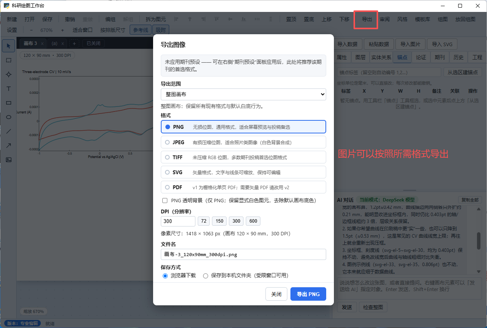
